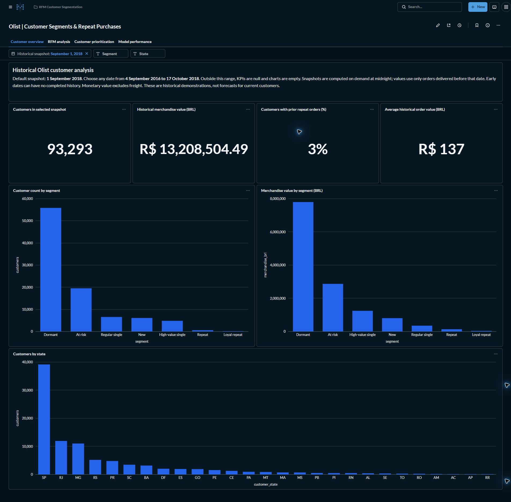
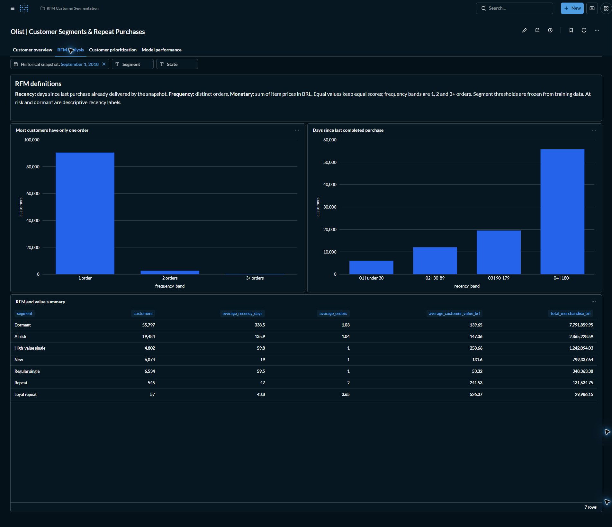
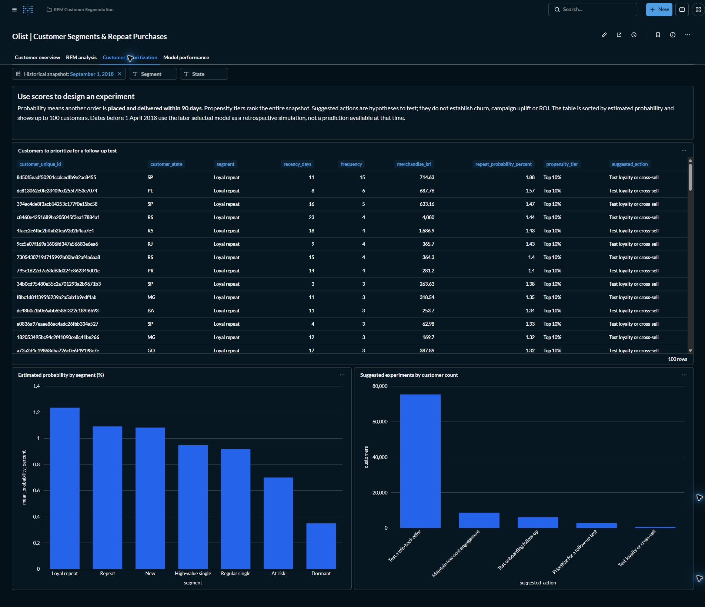
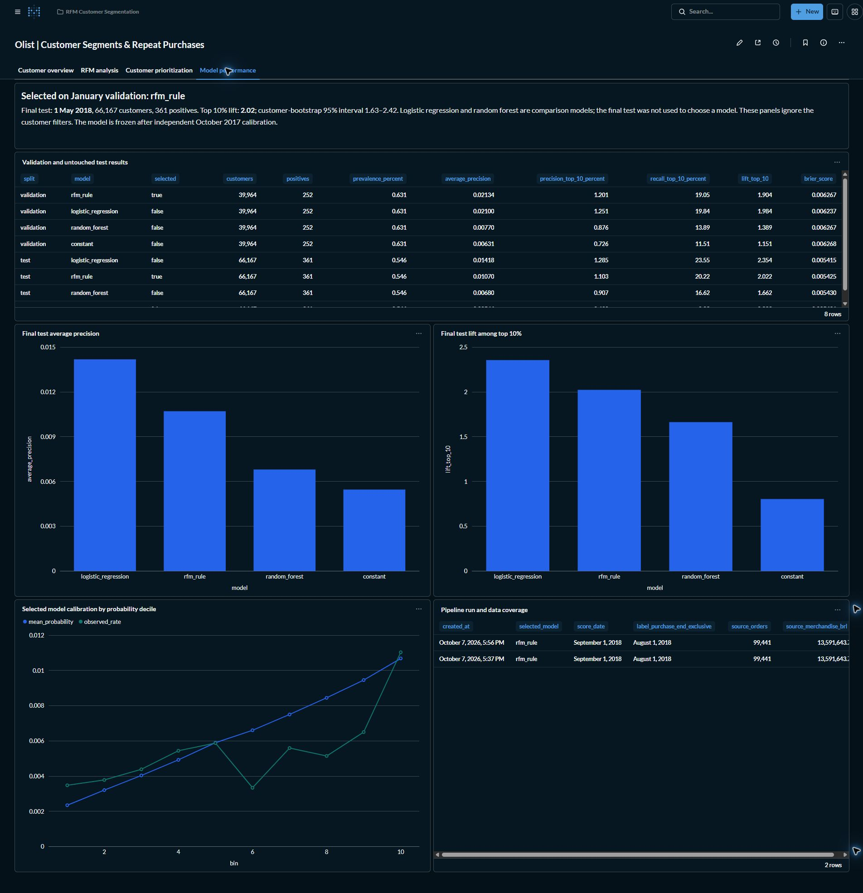

# RFM Customer Segmentation + Repeat-Purchase Prediction

A portfolio showcase of historical Olist customer segmentation and repeat-purchase analysis, presented in Metabase. Demo snapshot: **September 1, 2018**.

## Customer overview

Customer totals, merchandise value, repeat-order history and average order value, with segment and state distributions.

## RFM analysis

Recency and order-frequency distributions, plus customer counts and merchandise value across RFM segments.

## Customer prioritization

Customers ranked by estimated 90-day repeat-purchase probability, with propensity tiers and suggested follow-up experiments.

## Model performance

Validation and test comparisons, average precision, top-decile lift, probability calibration and data-coverage audit.

*Historical demonstration for portfolio viewing.*

## Private implementation

[Implementation repository](https://github.com/Manas96920/rfm-customer-segmentation-repeat-purchase-prediction-private) — access is restricted to authorized users.

## Business solutions

For custom customer analytics, retention dashboards and automated BI solutions, contact [manasranjan96920@gmail.com](mailto:manasranjan96920@gmail.com).
